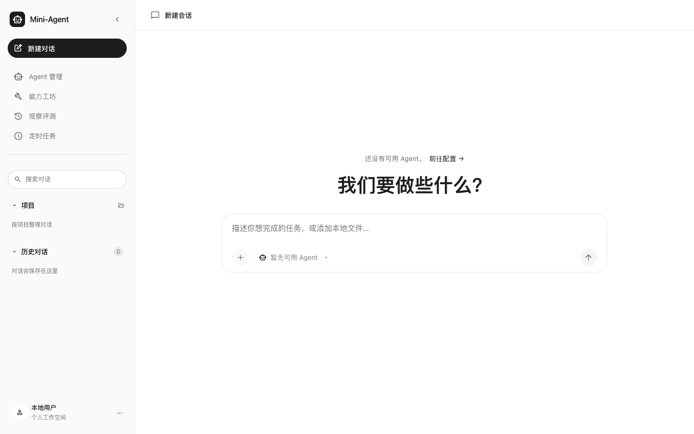
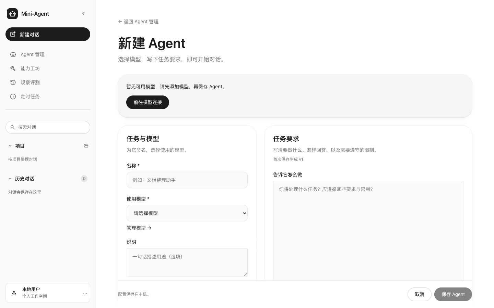
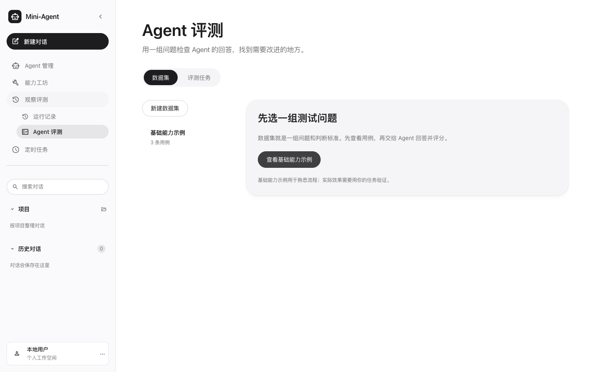

# Mini Agent

**在本机配置、运行和评测自己的 Agent。**

Mini Agent 把模型连接、Agent 配置、聊天、工具调用、运行记录和评测放在一个工作台里。连接自己的模型，写下任务要求，再按需加入 Skills 和 MCP，就可以开始使用。

[快速开始](#快速开始) · [界面预览](#界面预览) · [通用助手案例](examples/general-assistant/README.md) · [全部文档](docs/README.md)



*聊天工作台。截图来自首次启动的空白配置环境，连接模型并创建 Agent 后即可对话。*

## 适合谁

适合正在学习 Agent 的人：从配置一个助手开始，理解任务指令、模型、工具和 Skill 如何配合，再通过运行记录查看执行过程。

也适合想做本地原型的开发者，以及需要配置资料整理、任务规划或本地文本处理助手的人。前端使用 Vue 3，后端使用 FastAPI；聊天、定时任务和评测共用 Agent Runtime，核心实现有明确的代码入口。

## 能解决什么问题

| 你想做什么 | 在 Mini Agent 中怎么做 |
| --- | --- |
| 为不同任务配置可复用的助手 | 为 Agent 选择模型、保存任务指令，绑定需要的工具、Skills 和 MCP |
| 整理资料、规划任务或处理本地文本 | 在聊天中提供材料，按需加载 Skill；文件操作限定在授权工作目录 |
| 看清一次任务怎样执行、哪里出错 | 查看运行事件、工具结果、耗时和模型返回的 Token 用量 |
| 检查修改指令后的回答效果 | 建立问题与判断标准，用评测和人工复核检查回答 |

可以先跑通 [通用助手案例](examples/general-assistant/README.md)，再按 [第一次评测](docs/第一次评测.md) 建立自己的验证流程。

## 界面预览

下面是现有页面的真实截图，未填入模型密钥、个人会话或演示成绩。

<details>
<summary>查看 Agent 配置与评测页面</summary>

### 配置 Agent

选择模型，写下任务要求；工具和技能按需绑定。没有模型时，页面提供连接入口。



### 检查回答效果

从内置基础示例了解评测流程，再创建自己的数据集。示例用于熟悉操作，实际效果需要用自己的任务验证。



</details>

## 快速开始

下载源码并进入项目目录。准备 Node.js 22.12+、npm 和 uv；Python 3.12 由 uv 管理。在两个终端分别运行：

```sh
# 终端一：后端，初始化 SQLite 并启动服务
cd backend
uv sync --locked
uv run alembic upgrade head
uv run uvicorn app.main:app --host 127.0.0.1 --port 8000 --reload
```

```sh
# 终端二：前端
cd frontend
npm ci
npm run dev
```

打开 [本地工作台](http://127.0.0.1:5173)，连接自己的 Chat Completions 兼容模型。测试成功后，点击“用这个模型创建 Agent”，填写名称和指令，即可开始对话。首次使用无需配置 MCP 或 Skills。

模型调用使用你自己的 API Key，可能产生费用。需要工具调用时，请选择支持该能力的模型。详细配置见 [使用指南](docs/使用指南.md)。

## 从哪里看

具体操作见 [使用指南](docs/使用指南.md)。阅读代码时，从 [架构说明](docs/架构说明.md) 和 [开发指南](docs/开发指南.md) 开始；全部入口见 [文档导航](docs/README.md)。

```text
frontend/   Vue 前端、页面交互测试
backend/    FastAPI 后端、数据库迁移与测试
examples/   通用助手配置与可导入 Skills
docs/       使用、开发、设计文档；历史记录集中在 archive/
AGENTS.md   开发约定
```

## 使用范围

当前提供源码启动方式，面向本地单用户，默认仅监听本机。MCP 支持本机 stdio；Shell 仅支持具备可用沙箱的 macOS。文件操作限制在授权目录，Skills 提供指令，不直接执行代码。模型未返回用量时，相关统计保留缺失状态。

配置、会话和运行记录保存在本地 SQLite，Skills 保存在本地文件。模型密钥和 MCP 环境变量加密保存；数据库与项目外主密钥需分别备份。数据库、密钥和个人工作文件不应提交到 GitHub，具体路径与备份说明见 [使用指南](docs/使用指南.md)。

## 许可证

项目原创代码与文档采用 [MIT License](LICENSE)，允许使用、修改、分发和商用，需保留版权与许可证声明。

第三方资源沿用各自许可证。Material Symbols 图标采用 Apache-2.0，声明见 [LICENSE](frontend/src/assets/material-symbols/LICENSE) 与 [NOTICE](frontend/src/assets/material-symbols/NOTICE)；依赖包遵循各自许可证。
