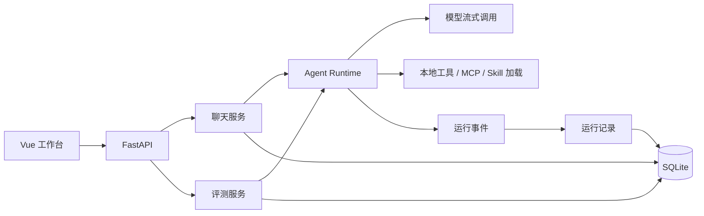

# 架构说明

[文档导航](README.md) · [开发指南](开发指南.md)

前端负责配置与结果展示。聊天和评测共用一个 Runtime，能力管理、执行与数据存储各自独立。

这里的 Harness 是 Agent 的运行内核：负责模型与工具循环、上下文管理、执行限制、取消和事件记录。聊天、定时任务与评测共用这套内核。前端采用 Vue 3、TypeScript、Vite、Pinia 和原生 CSS；后端采用 Python 3.12、FastAPI、SQLAlchemy、SQLite 和 Alembic。

| 职责 | 代码入口 |
| --- | --- |
| 应用装配、服务生命周期 | [main.py](../backend/app/main.py) |
| 会话持久化、幂等发送、事件转发 | [chat.py](../backend/app/services/chat.py) |
| 上下文、模型与工具循环、取消和限制 | [agent_runtime.py](../backend/app/services/agent_runtime.py) |
| 本地工具参数与权限校验 | [tool_execution.py](../backend/app/services/tool_execution.py) |
| MCP 管理和 stdio 协议 | [mcp.py](../backend/app/services/mcp.py) |
| Skill 文件管理与运行读取 | [skills.py](../backend/app/services/skills.py) |
| 运行事件持久化、摘要、成本 | [runs.py](../backend/app/services/runs.py) |
| 数据集、评测执行、评分与复核 | [evaluations.py](../backend/app/services/evaluations.py) |

## 一次任务如何运行

聊天先提交用户消息，再调用 Runtime。Runtime 加载配置，构建模型上下文，发送请求；出现工具调用时重新校验可用能力，执行并将结果返回模型，直到完成、失败、取消或达到限制。

运行事件用于前端过程展示和运行记录。评测服务复用同一个执行入口，再用评分模型与过程规则检查回答。运行完成和回答通过评分是两个不同概念。

## 关键取舍

SQLite 适合当前本地单用户场景，减少安装依赖。MCP 和本地工具通过既有受控入口执行；引入通用 Agent 功能不会自动扩大工具权限。Skills 是按需加载的指令，不能直接执行代码。

模型服务通过统一 Chat Completions 接口接入，因此只支持兼容当前参数和工具调用协议的服务。评测包含配置快照与变更检查，但外部模型和工具仍可能变化，不能承诺逐字复现。

详细开发和隔离规则见 [AGENTS.md](../AGENTS.md)。

## 参考项目

流程组织参考 [Open Agent Platform](https://github.com/langchain-ai/open-agent-platform)，简明架构表达参考 [nanobot](https://github.com/HKUDS/nanobot)，运行观察参考 [AgentScope Studio](https://github.com/agentscope-ai/agentscope-studio)，评测组织参考 [promptfoo](https://github.com/promptfoo)。上述参考用于流程与信息组织，未移植这些仓库的代码。
